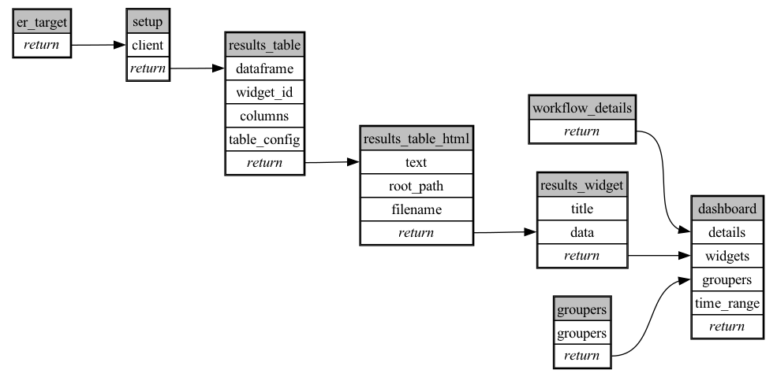

```
# AUTOGENERATED BY ECOSCOPE-WORKFLOWS; see fingerprint in README.md for details

```

```yaml
# fingerprint:
artifacts_sha256_basic: 7ab118f3d160b12a64bcd56e1149b7b886c209bc381363985c707d68c266f634
artifacts_sha256_strict: 56b574dc37efdc3936a149552b713af59b65c4dbd79bb15ae5e517c6350ec3f3
installed_requirements:
- channel: https://repo.prefix.dev/ecoscope-workflows/
  name: ecoscope-platform
  version: {version: ==2.21.0}
- channel: https://repo.prefix.dev/ecoscope-workflows-custom/
  name: ecoscope-workflows-ext-wdmodel
  version: {version: ==0.2.0}
- channel: conda-forge
  name: pydeck
  version: {version: ==0.9.2}
params_sha256: 558bb22a5e4cf4b38ef7c33cb7da2366825d2930308dc7f7689d952a454de320
spec_sha256: 02ba4de93bd9f4c084ec546f874dc0801f188d620ba5404d9f4cc74be80737e8

```

# ecoscope-workflows-wd-data-model-setup-workflow


