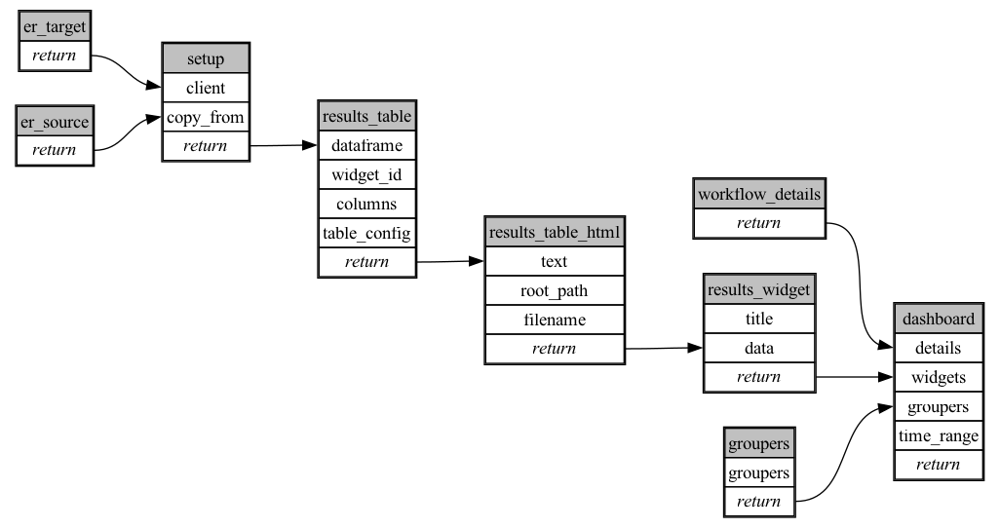

```
# AUTOGENERATED BY ECOSCOPE-WORKFLOWS; see fingerprint in README.md for details

```

```yaml
# fingerprint:
artifacts_sha256_basic: dd026b15358d537662443a1c778cf262d51295207bee32e732e670ebe806ee96
artifacts_sha256_strict: e721f2d2b552e287d0748f4649cf9dcd8c4316daa1dfc514eac0d759c0d4c2a4
installed_requirements:
- channel: https://repo.prefix.dev/ecoscope-workflows/
  name: ecoscope-platform
  version: {version: ==2.21.0}
- channel: file:///tmp/ecoscope-workflows-custom/release/artifacts/
  name: ecoscope-workflows-ext-wdmodel
  version: {version: ==0.0.1}
- channel: conda-forge
  name: pydeck
  version: {version: ==0.9.2}
params_sha256: d3538f09755def7e831c0e47c505f9a62d78000e372670c35e49ea6788767f41
spec_sha256: b7e1bcf6d2665e84ef5fba499cde7db0c94c35415cba9c0267c8c012d66c35c7

```

# ecoscope-workflows-wd-data-model-setup-workflow


